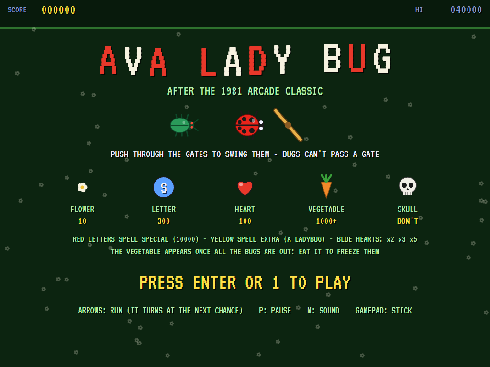
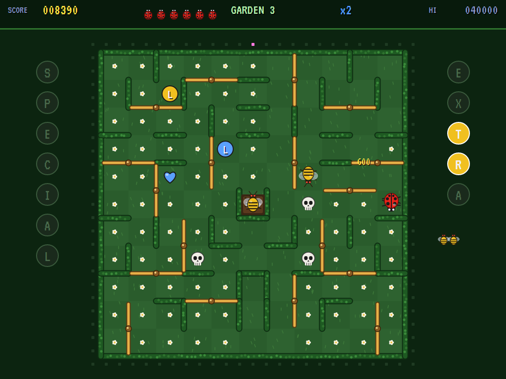
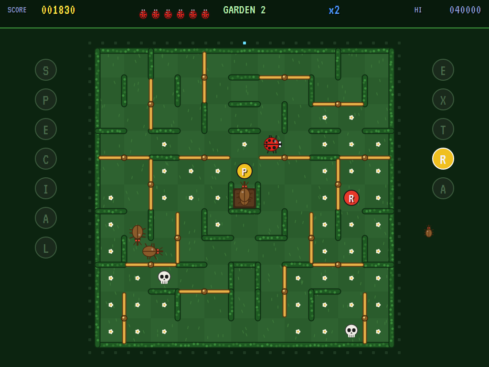
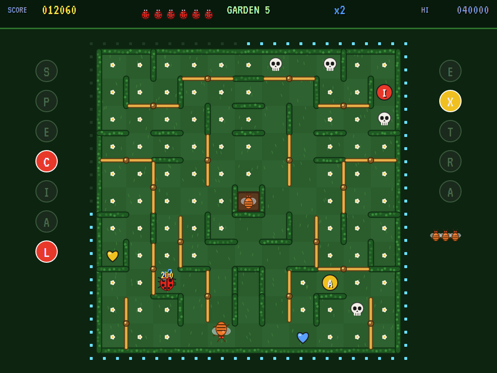
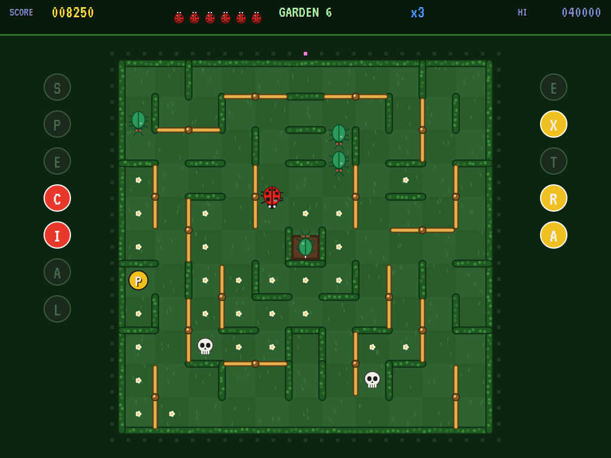
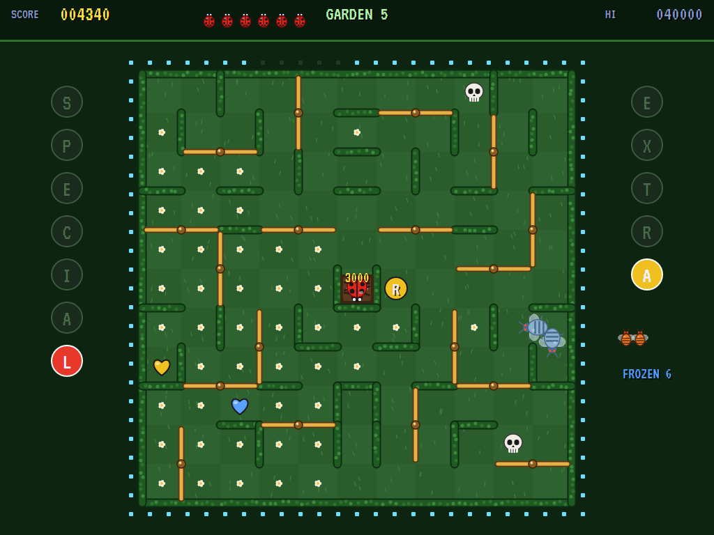
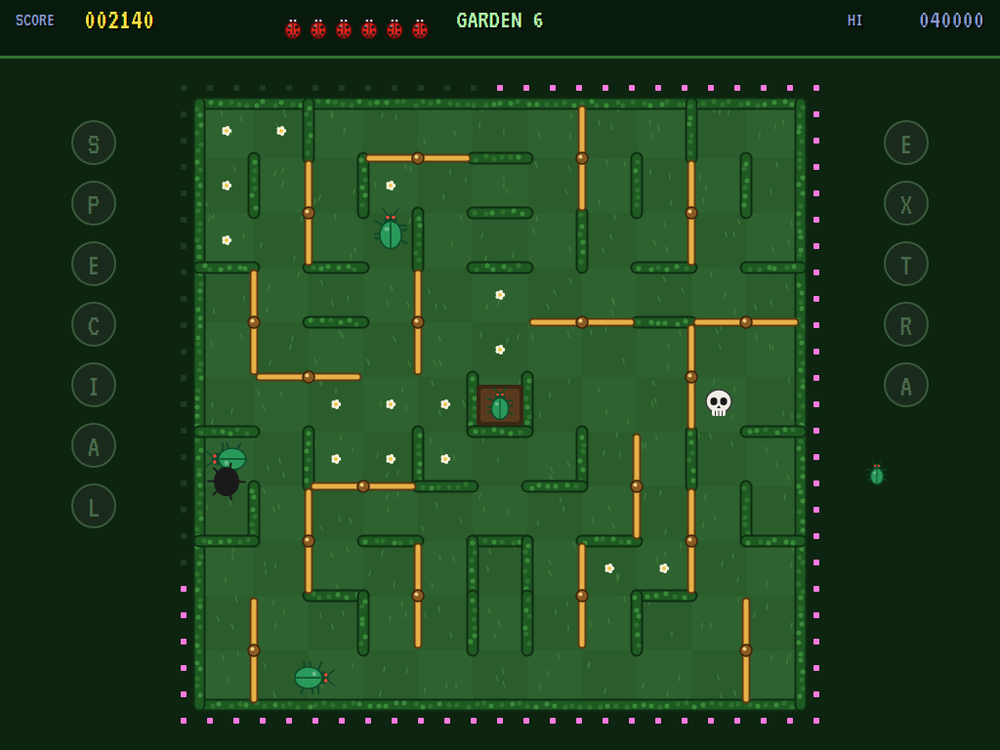
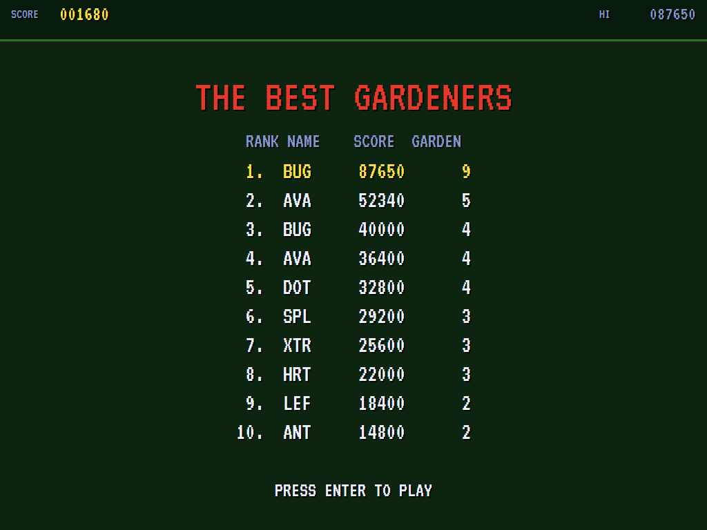

# AVA Lady Bug

[](https://github.com/Harlock123/AVALadyBug/actions/workflows/build.yml)

A garden maze game in the style of Universal's 1981 arcade game **Lady Bug**, built with .NET 10 and
Avalonia UI. A ladybug runs the paths of a hedged garden, eating every flower. Bugs come out of the nest
in the middle, one each time the timer runs round the garden's edge. The garden is full of **revolving
gates**: the ladybug can push through any of them, swinging it a quarter turn, but a bug can't pass a gate
at all. Swing them behind you to shut the bugs out.

## Features

- **The gates** are wooden bars on a post at a corner of the grid. Each lies across two paths. Push
  through and it swings round to lie across the other two. The bugs have to go the long way round
  whichever way they stand. The garden is laid out so that every square can be reached however the gates
  are turned.
- **What's in the garden:**
  - **Flowers** (10) fill every square.
  - **Letters** (300) and **hearts** (100) change colour as you watch, red, yellow and blue, and what
    they do depends on the colour when you eat them:
    - A **red letter** lights its place in **SPECIAL**. The whole word is worth 10,000.
    - A **yellow letter** lights its place in **EXTRA**. The whole word is an extra ladybug.
    - A **blue heart** steps up what everything's worth for the rest of the garden: x2, x3, then x5.
  - **Skulls** are the end of the ladybug, and of any bug that runs onto one (the bug goes back to the
    nest to wait its turn again).
  - **The vegetable** (1,000, more in later gardens) appears in the nest once every bug is out. Eating it
    freezes the bugs for six seconds.
- **The bugs**: four a garden, a new kind each garden (beetles, weevils, wasps, mantises, hornets). At
  each turning they head for the ladybug or wander. Later gardens bring faster bugs, more chasing, a
  quicker timer and more skulls. The ladybug is always the quickest.
- **Each garden** has the same layout of gates and hedges, and its own fixed letters, hearts and skulls.
  Eat every flower, letter and heart to move on.
- **The attract mode** plays itself. The computer player weighs each way at every turning: how far to the
  nearest thing to eat, never over a skull, and how near the bugs could get going the ways bugs can
  (round the gates as they stand). It makes for the vegetable when it's out, and turns straight round if a
  bug is right ahead.
- **The sounds** are all synthesised: chirps for flowers, a creak and clack for each gate, buzzing bugs,
  fanfares for SPECIAL and EXTRA, and a skipping tune.

## Screenshots

| The title | The first garden | A gate swinging |
|:---------:|:----------------:|:---------------:|
|  |  |  |
| What's in the garden. | Beetles out of the nest. | Weevils, and EXTRA's R lit. |

| Letters and hearts | The vegetable | Frozen |
|:------------------:|:-------------:|:------:|
|  |  |  |
| A multiplier going. | Every bug out. | Six seconds of peace. |

| Caught | The high scores | |
|:------:|:---------------:|:-:|
|  |  | |
| Over on its back. | The best gardeners. | |

The screenshots are made by the tests, which play the game in a real (headless) window; see
[Tests](#tests).

## Download and run

Ready-to-run builds for Windows, macOS and Linux, on both Intel/AMD and ARM, are on the
[Releases page](https://github.com/Harlock123/AVALadyBug/releases/tag/latest). **Latest build** is
rebuilt on every push to `main`. Each download is one self-contained executable: no .NET install is
needed.

| Platform | Archive |
|---|---|
| Windows | `AVALadyBug-win-x64.zip`, `AVALadyBug-win-x86.zip`, `AVALadyBug-win-arm64.zip` |
| macOS | `AVALadyBug-osx-arm64.tar.gz` (Apple silicon), `AVALadyBug-osx-x64.tar.gz` (Intel) |
| Linux | `AVALadyBug-linux-x64.tar.gz`, `AVALadyBug-linux-arm64.tar.gz`, `AVALadyBug-linux-arm.tar.gz` |

```bash
tar -xzf AVALadyBug-linux-x64.tar.gz     # or linux-arm64, linux-arm, osx-arm64, osx-x64
./AVALadyBug
```

On Windows, unzip and run `AVALadyBug.exe`. On macOS, if Gatekeeper refuses to open it, run
`xattr -d com.apple.quarantine AVALadyBug` once. Run with `--no-audio` for silence.

**Sound** comes through OpenAL Soft, built in for every platform. In a virtual machine the game
detects it and uses a larger audio buffer, so the sound doesn't break up.

**Gamepads** use SDL2, which is bundled for Windows, macOS and Intel/AMD Linux. ARM Linux builds need it
installed; without it the keyboard still works:

```bash
sudo apt install libsdl2-dev            # Debian / Ubuntu / Raspberry Pi OS
sudo pacman -S --needed sdl2-compat     # Arch / Omarchy
```

## Controls

| Action | Keyboard | Gamepad |
|---|---|---|
| Start | Enter or 1 | Start |
| Run (it turns at the next chance) | Arrow keys (or W A S D) | Left stick / D-pad |
| Pause | P or Esc | Start |
| Quit (while paused) | Esc | Back |
| Sound on/off | M | |
| Screenshot | Ctrl+S (to your Pictures folder) | |

On the high-score table, type your initials, or use up/down and Space, then Enter.

## Tests

```bash
dotnet test AVALadyBug.slnx
```

The engine has no UI and runs in fixed 60 Hz steps, so it plays the same at any frame rate, and a seed
always plays the same game. The tests check:

- **The garden:** every square reachable however the gates stand; each garden's letters, hearts and
  skulls the same every time, with flowers everywhere else, and more skulls later
- **The ladybug:** running the paths, eating, and stopping at hedges; a turn taken at the next chance and
  straight back at once; pushing through a gate and the gate then barring the bugs; red letters, yellow
  letters and whole words; blue hearts stepping up the multiplier; a skull
- **The bugs:** the timer letting them out and the vegetable once all are out; never through a gate; a
  bug lost to a skull going back to the nest; catching the ladybug; later gardens fiercer, but never
  faster than the ladybug; the vegetable freezing them
- **The machine:** clearing a garden; the last ladybug lost, and initials; the title, demonstration and
  high scores, and starting a game; the arrow keys running the right way; the computer player clearing
  the first garden, and wandering at random losing

The screenshot tests draw the real screen in a headless window. To refresh the README's pictures:

```bash
LADYBUG_SHOTS=$PWD/Images dotnet test tests/AVALadyBug.Tests --filter ScreenshotTests
```

To see how the computer player gets on, garden by garden (`1` for the pilot, `lazy` for one that turns
at random now and then):

```bash
LADYBUG_PROBE=1 dotnet test tests/AVALadyBug.Tests --filter PilotProbe --logger "console;verbosity=detailed"
```

## Building

```bash
dotnet build AVALadyBug.slnx
dotnet run --project src/AVALadyBug
```

Needs the .NET 10 SDK. The sounds are made by `tools/make_sounds.py` (standard-library Python):
`python3 tools/make_sounds.py` rewrites `src/AVALadyBug/Sounds`.

## Project structure

```
AVALadyBug/
├── AVALadyBug.slnx
├── src/AVALadyBug/
│   ├── Engine/
│   │   ├── GameEngine.cs        # States, the title and demo cycle, the music
│   │   ├── GameEngine.Play.cs   # The ladybug, the gates, the bugs and the timer, letters, hearts and skulls
│   │   ├── LadybugPilot.cs      # The computer player, for the demonstration (and the tests)
│   │   ├── Entities.cs          # The garden's layout, its hedges and gates, and everything in it
│   │   ├── HighScoreTable.cs, InitialsEntry.cs
│   │   ├── InputHandler.cs, ControllerManager.cs  # Keys and an SDL2 gamepad
│   │   └── SoundManager.cs      # Effects and the tunes through OpenAL
│   ├── Audio/                   # The OpenAL engine (from the author's AVABand)
│   ├── Views/                   # The drawing: the garden, the gates, the ladybug and the bugs, the screens
│   └── Sounds/                  # The synthesised effects and tunes
├── tests/AVALadyBug.Tests/      # Gameplay, screenshot and probe tests
├── tools/make_sounds.py
└── Images/                      # Screenshots
```

## About and licence

AVA Lady Bug © 2026 Lonnie Watson, under the [MIT License](LICENSE).

*Lady Bug* © 1981 Universal; the name belongs to its current owner. AVA Lady Bug is an independent,
unofficial game in its style. Its garden, gates, bugs and ladybug, its graphics, sounds, tunes and code
are its own; nothing is taken from the arcade machine's program, graphics, sound or music. It is not
affiliated with or endorsed by any rights holder.
